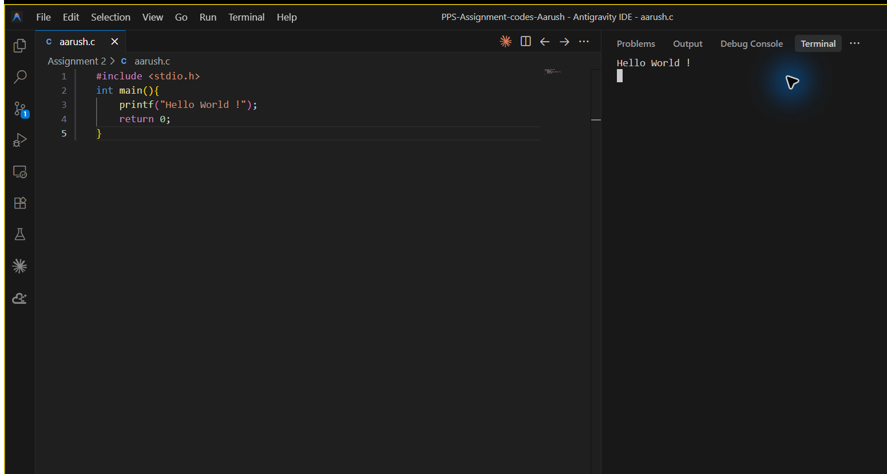
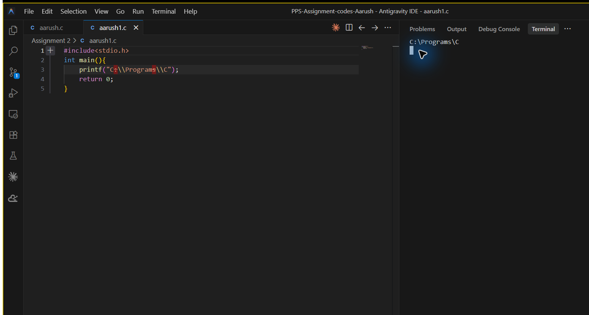
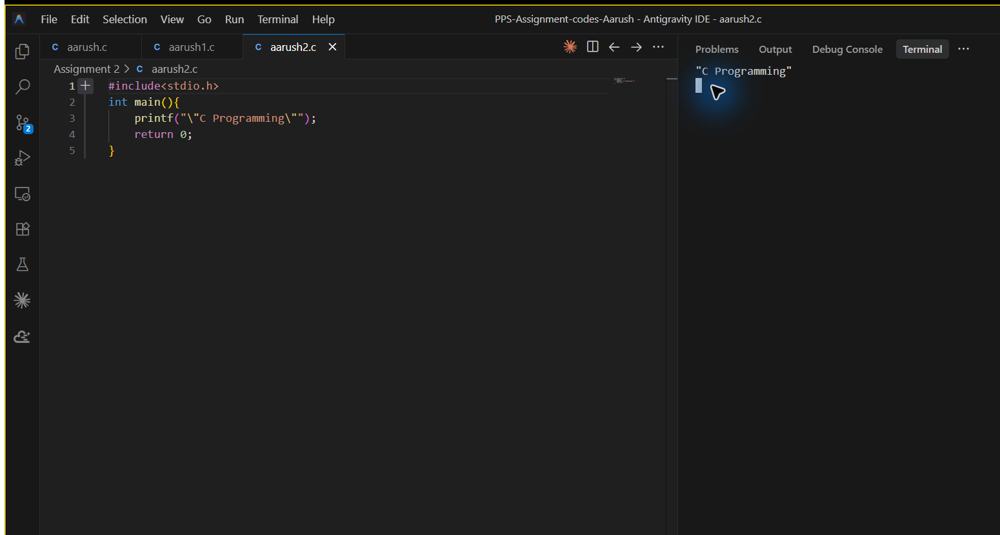
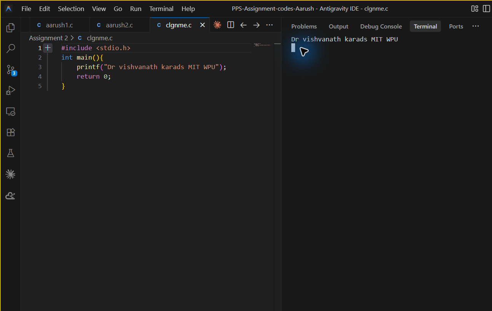
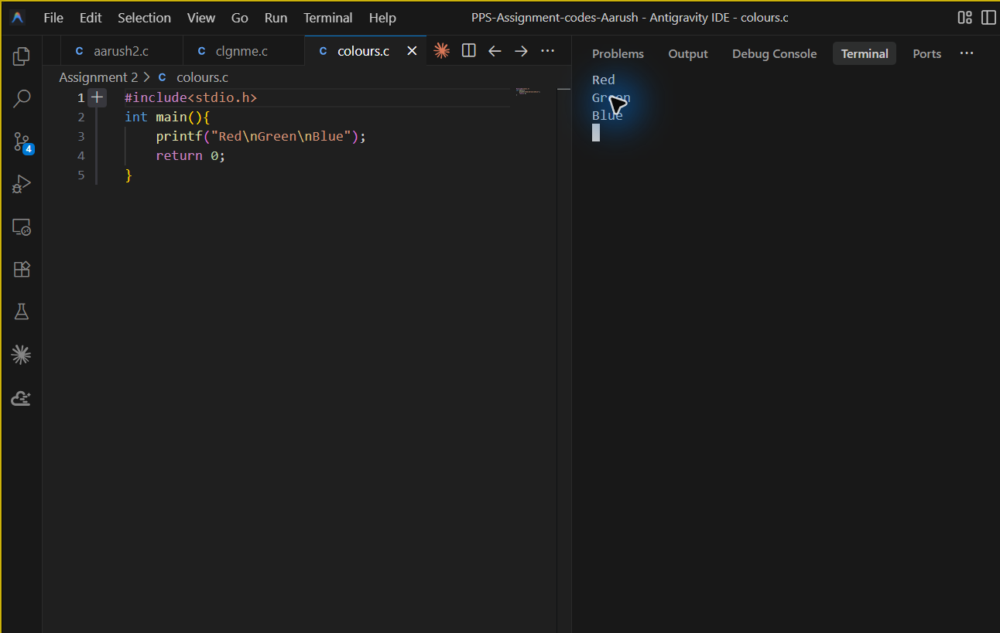
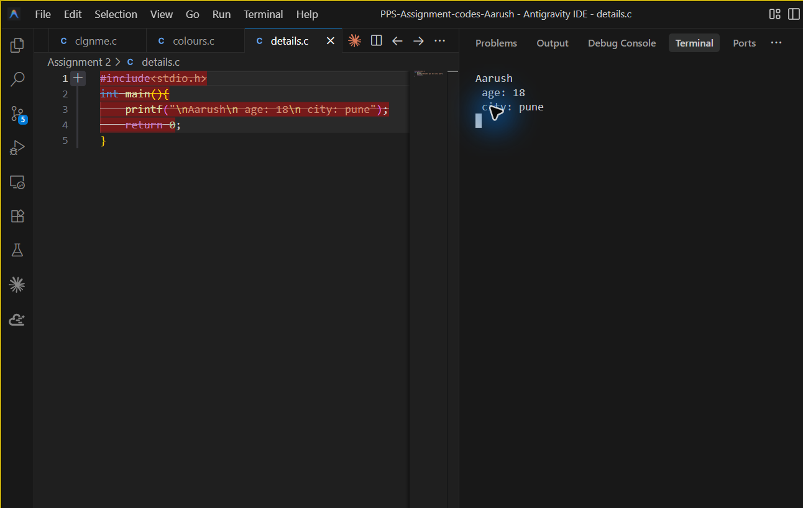
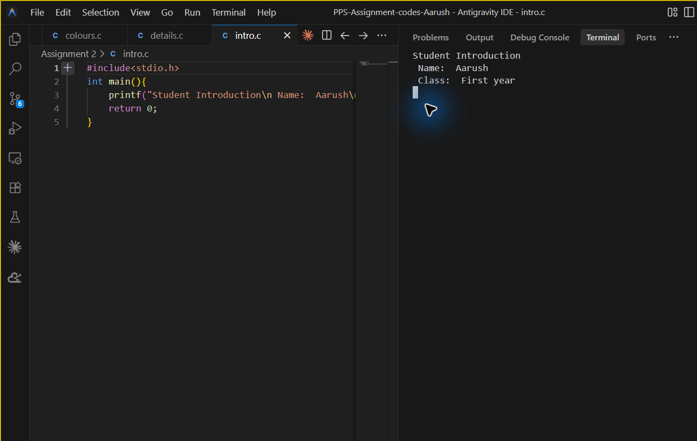
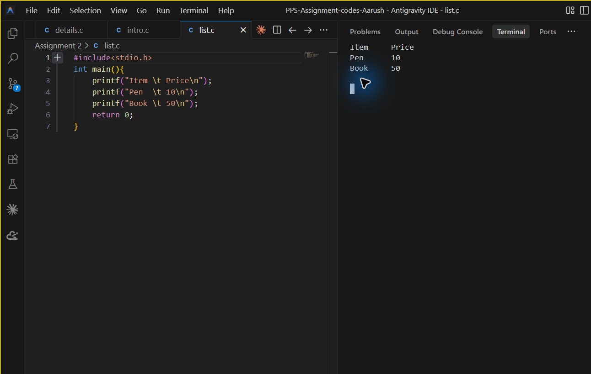
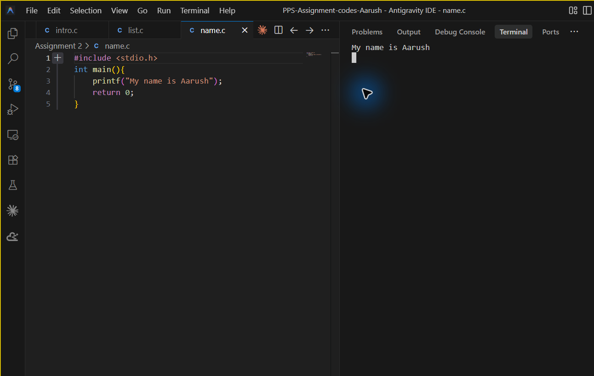
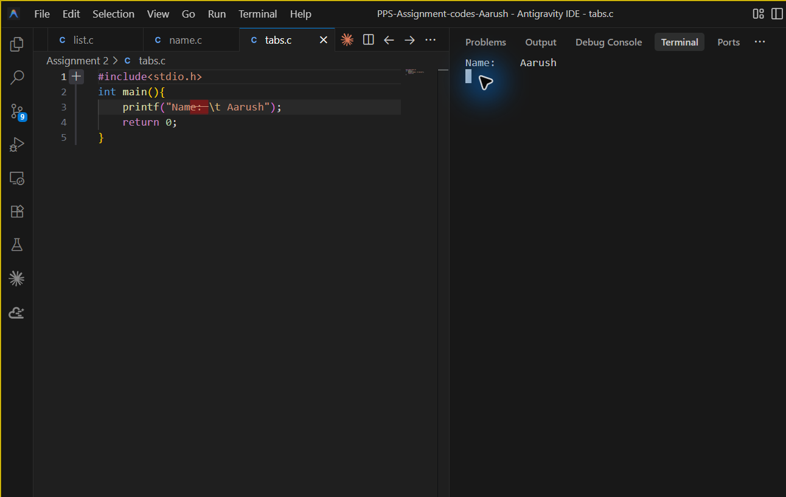

# Assignment 2

| Code | Code and output screenshot |
| --- | --- |
| [aarush.c](aarush.c) |  |
| [aarush1.c](aarush1.c) |  |
| [aarush2.c](aarush2.c) |  |
| [clgnme.c](clgnme.c) |  |
| [colours.c](colours.c) |  |
| [details.c](details.c) |  |
| [intro.c](intro.c) |  |
| [list.c](list.c) |  |
| [name.c](name.c) |  |
| [tabs.c](tabs.c) |  |
